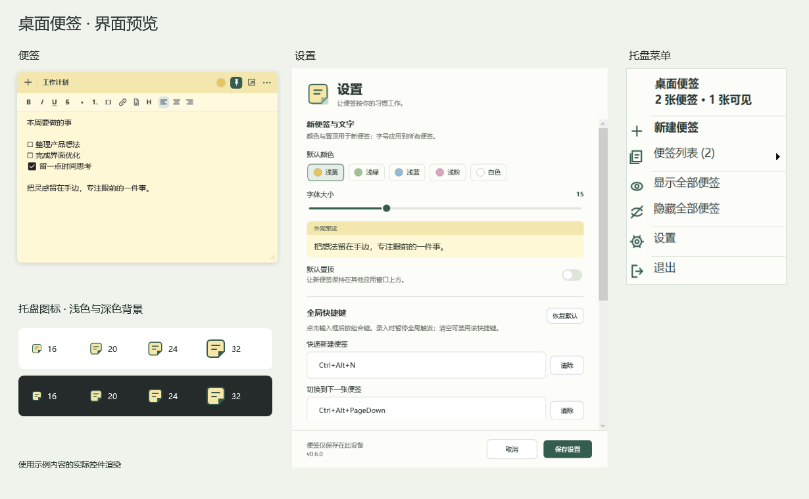
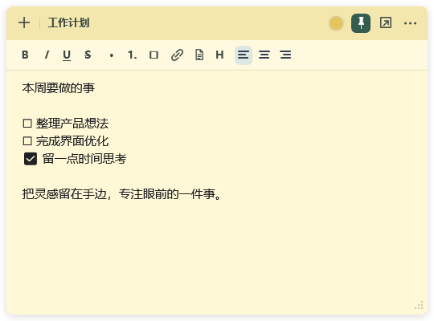
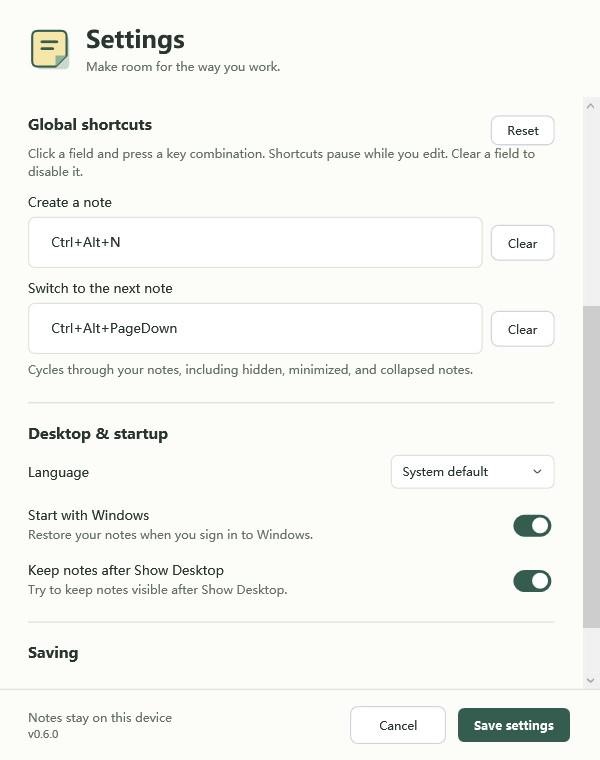

# DeskStickyNotes

DeskStickyNotes is a lightweight, open-source desktop sticky notes app for Windows 10/11 x64, inspired by the Windows 7 sticky-note workflow.

Keep a reminder in view, pin an important note, or jump between notes from the keyboard. DeskStickyNotes combines a native WPF paper-style interface, rich text, a compact draggable icon mode, tray management, and local storage without an account.

中文文档: [README.zh-CN.md](README.zh-CN.md)

## New In 0.6.0

- Customizable global shortcuts: `Ctrl+Alt+N` creates a note; `Ctrl+Alt+PageDown` cycles through notes, including hidden, minimized, and collapsed ones.
- Seven UI languages: English, Simplified Chinese, Traditional Chinese, French, Spanish, Portuguese, and Japanese.
- Refreshed note controls, tray icons/menu, and settings with live appearance previews and a fixed Save/Cancel footer.
- Coordinated desktop recovery avoids overlapping notes repeatedly competing for the top position; collapsing preserves each note's saved pin preference.

[Download 0.6.0](https://github.com/ht7850142/DeskStickyNotes/releases/tag/v0.6.0) · [Changelog](CHANGELOG.md)

## AI-Assisted Development

This project uses AI assistance for implementation, UI iteration, documentation, and packaging. The maintained [Chinese development specification](docs/开发提示词.md) describes the current 0.6.0 behavior and engineering requirements; earlier revisions remain in Git history.

## Why

Windows 11 Sticky Notes behaves like a regular app window and does not provide the old desktop-widget feeling. DeskStickyNotes focuses on one narrow use case: visible desktop notes that can stay on top when you need them.

- desktop-first note windows
- per-note always-on-top
- compact collapsed icon mode for topmost notes
- tray-managed sticky notes
- lightweight local storage
- portable or installer-based distribution
- simple rich text without a full note-taking platform

## Strengths

- **Visible desktop notes for Windows 11**: notes feel like lightweight desktop objects instead of a full note-taking workspace.
- **Per-note always-on-top**: pin important notes above other windows when you need them to remain visible.
- **Collapsed icon mode**: keep a topmost note available without letting a full note window cover your work area.
- **Tray-managed, taskbar-clean workflow**: normal note windows stay out of the taskbar, while the tray menu handles note creation, visibility, settings, and exit.
- **Local-first and private**: notes are saved as local JSON files under `%AppData%`; there is no account, sync, analytics, or network feature.
- **Small but practical editor**: rich text, todo items, headings, alignment, hyperlinks, compact text slices, colors, adjustable note transparency, and a clean Windows-friendly UI.
- **Portable or installed**: users can choose a small framework-dependent package or a runtime/self-contained package.
- **Open-source and AI-assisted**: the codebase is readable, documented, and includes the original development prompt.

## Best For

- users who miss Windows 7 Sticky Notes on Windows 11
- users who want important notes to stay visible above other windows
- users who want a compact always-on-top reminder icon
- users who want sticky notes without Microsoft account or cloud sync
- users who prefer a tray-managed desktop notes app
- users who want a lightweight open-source Windows sticky notes tool
- developers looking for a small WPF/.NET desktop app example

## Features

- Multiple independent sticky-note windows
- Rename each note by double-clicking its title bar, using its title-bar/icon context menu, or pressing F2; names are saved automatically
- Right-click the tray icon to browse all notes by name and show or hide each note independently
- No taskbar button for normal note windows
- System tray menu: New Note, Show All Notes, Hide All Notes, Settings, Exit
- Double-click tray icon to show existing notes
- Customizable global shortcuts to create a note and cycle through all notes, including hidden, minimized, and collapsed notes
- Auto-save note content, position, size, color, transparency, text color, visibility, and topmost state
- Per-note background opacity with Auto, Dark, and Light text color modes
- Rich text editing: bold, italic, underline, strikethrough, bullets, numbering, todo items, headings, alignment, and hyperlinks
- Turn selected or clipboard text into a compact slice that opens in a full-text preview
- Drag, paste, or choose common text, Markdown, JSON, CSV, log, and source-code files to import them as slices
- Imported text files are local snapshots, so their previews keep working if the originals move or are deleted
- Restore notes on startup
- Per-note always-on-top
- Collapse a note into a small draggable icon
- Resize notes by dragging any edge or corner; custom sizes are saved even for empty notes
- Compact notes down to 300 × 180 with grouped, wrapping tools, current-format indicators, and keyboard access
- Click the title bar to keep editing, drag to move, and use the dedicated collapse button; expansion preserves the saved pin preference
- Empty-note guidance and scrollbars for overflowing content; restore collapsed notes with Enter or Space
- Expanding an icon near a screen edge keeps the note inside that monitor's available work area
- Optional "Keep after Win+D" best-effort behavior
- Light Windows 11-friendly note and settings UI
- Simplified Chinese, Traditional Chinese, English, French, Spanish, Portuguese, and Japanese UI, plus Auto language detection
- Start with Windows through `HKCU\Software\Microsoft\Windows\CurrentVersion\Run`
- Local JSON storage under `%AppData%\DeskStickyNotes`

### Global shortcuts

The default shortcuts are `Ctrl+Alt+N` to create a note and `Ctrl+Alt+PageDown` to switch to the next note. Cycling follows note creation order and reveals hidden, minimized, and collapsed notes.

Open **Settings → Global shortcuts**, click a shortcut field, and press the desired combination. Use Ctrl, Alt, or Win with another key; Shift is optional. Clear a field to disable that shortcut, or choose Reset to restore both defaults. Shortcuts pause while a field is recording. Save checks for duplicate or occupied combinations and keeps the previous working shortcuts if a replacement is unavailable.

### Languages

Choose **Auto**, **简体中文**, **繁體中文**, **English**, **Français**, **Español**, **Português**, or **日本語** in **Settings → Desktop & startup → Language**, then save. No restart is needed. Auto uses the Windows UI language, distinguishes Simplified and Traditional Chinese, and falls back to English for unsupported languages.

### Text slices

- Select text in a note and use the document button in the editor toolbar to tuck it into a slice.
- Copy a long passage and choose **Paste clipboard as a text slice**, or press `Ctrl+Shift+V`.
- Drop text files onto the note editor, or choose files from the slice menu, to create clickable file slices.
- Click a slice to read, scroll, wrap, or copy the full text in a separate preview window.
- Each text slice is limited to 2 MB, with an 8 MB text-slice limit per note.

## Download

For end users, download [DeskStickyNotes 0.6.0 from GitHub Releases](https://github.com/ht7850142/DeskStickyNotes/releases/tag/v0.6.0).

Recommended: [installer with the .NET Desktop Runtime included](https://github.com/ht7850142/DeskStickyNotes/releases/download/v0.6.0/DeskStickyNotesSetup-0.6.0-runtime.exe). For a build without installation, choose the [self-contained portable ZIP](https://github.com/ht7850142/DeskStickyNotes/releases/download/v0.6.0/DeskStickyNotes-portable-0.6.0-win-x64-runtime.zip).

| Package | Use when |
| --- | --- |
| `DeskStickyNotesSetup-*-fd.exe` | You already have the .NET 8 Desktop Runtime installed. Small installer. |
| `DeskStickyNotesSetup-*-runtime.exe` | You want an installer that includes the .NET 8 Desktop Runtime. Larger installer. |
| `DeskStickyNotes-portable-*-fd.zip` | You want a portable build and already have the .NET 8 Desktop Runtime. |
| `DeskStickyNotes-portable-*-runtime.zip` | You want a portable build that does not need a separate runtime install. |

Exit the previous version from the tray before upgrading, then install over it. The installer supports a custom install path. Installed and portable builds both keep notes and settings in `%AppData%\DeskStickyNotes`; the portable ZIP does not store notes beside the executable. All four package checksums are listed in the release's SHA-256 manifest.

## First Use

1. Start the app; its icon appears in the notification area, and the first launch creates a note.
2. Type to edit. Use `Ctrl+Alt+N` for another note and `Ctrl+Alt+PageDown` to cycle through notes.
3. Pin a note above other windows, or use its dedicated collapse button to turn it into a draggable reminder. Click the title bar to keep editing, drag to move, and double-click or press F2 to rename.
4. Right-click the tray icon to show/hide individual notes or open Settings for appearance, shortcuts, and language.

## Interface Preview

These images render the compiled 0.6.0 controls with sample notes. They contain no personal note data.

For reusable launch images, raw UI captures, and editable sources, see the [0.6.0 press kit](assets/banners/desksticky-0.6.0/README.md). The [publishing guide](docs/PUBLISHING.md) includes a researched channel shortlist and Chinese/English submission drafts.

### Notes, Settings, And Tray



### Note Window



### Customizable Global Shortcuts



## Requirements

For users:

- Windows 10/11 x64
- .NET 8 Desktop Runtime, unless using a runtime/self-contained package

For development:

- Windows 10/11
- .NET 8 Desktop SDK
- Inno Setup 6, only needed for installer builds

Install the SDK:

```powershell
winget install Microsoft.DotNet.SDK.8
```

If you use Visual Studio, install the ".NET desktop development" workload.

## Run From Source

```powershell
dotnet run --project .\src\DeskStickyNotes\DeskStickyNotes.csproj
```

The app starts in the system tray. If there are no saved notes, it creates one default note.

If `dotnet` is not recognized but the SDK is installed, restart your IDE or terminal first. You can also run the SDK directly:

```powershell
& 'C:\Program Files\dotnet\dotnet.exe' run --project .\src\DeskStickyNotes\DeskStickyNotes.csproj
```

## Build

```powershell
dotnet build -c Release
```

Run the Windows regression checks, including native window stacking, global shortcut registration/conflicts, local storage, and all seven language layouts:

```powershell
dotnet run --project tests/DeskStickyNotes.RegressionTests -c Release
```

## Package

Create a small framework-dependent installer and portable package:

```powershell
powershell -ExecutionPolicy Bypass -File .\scripts\package.ps1
```

Create all installer and portable variants:

```powershell
powershell -ExecutionPolicy Bypass -File .\scripts\package.ps1 -AllInstallers
```

Current package names:

```text
artifacts\installer\DeskStickyNotes-portable-0.6.0-win-x64-fd.zip
artifacts\installer\DeskStickyNotes-portable-0.6.0-win-x64-runtime.zip
artifacts\installer\DeskStickyNotesSetup-0.6.0-fd.exe
artifacts\installer\DeskStickyNotesSetup-0.6.0-runtime.exe
artifacts\installer\DeskStickyNotes-0.6.0-SHA256SUMS.txt
```

The packaging script downloads and verifies the Microsoft runtime installer automatically when it is missing:

```text
windowsdesktop-runtime-8.0.31-win-x64.exe
```

This file is ignored by Git because it is a local packaging dependency.

More details: [docs/RELEASE.md](docs/RELEASE.md)

## Data And Privacy

DeskStickyNotes stores notes and settings locally:

```text
%AppData%\DeskStickyNotes\notes.json
%AppData%\DeskStickyNotes\settings.json
```

There is no account system, sync service, telemetry, analytics, or network feature in the app itself. Note content stays on the local machine unless the user copies or backs it up elsewhere.

## Known Limitations

`Keep after Win+D` is best effort. Windows "Show Desktop" is shell-level behavior, and ordinary app windows cannot perfectly behave like real desktop icons or widgets in every scenario. Always-on-top and collapsed-icon mode are the reliable options when a note must stay visible.

## Project Structure

```text
DeskStickyNotes.sln   Visual Studio / dotnet solution
src/DeskStickyNotes/   WPF app source code
  Models/             Data models and note palette
  Services/           Storage, tray, hotkeys, desktop recovery, startup, and localization
  ViewModels/         MVVM view models and commands
  Views/              WPF windows
  Localization/       Complete resources for seven UI languages
  Themes/             Shared control styles, states, and UI tokens
  Assets/             App icon files
installer/            Inno Setup script and installer image
scripts/              Packaging script
docs/                 Architecture, release guide, development prompt, and images
```

Architecture notes: [docs/ARCHITECTURE.md](docs/ARCHITECTURE.md)

## Contributing

Issues and pull requests are welcome. Please keep the project focused: small, native Windows, tray-managed, local-first sticky notes.

See [CONTRIBUTING.md](CONTRIBUTING.md).

## License

MIT License. See [LICENSE](LICENSE).
