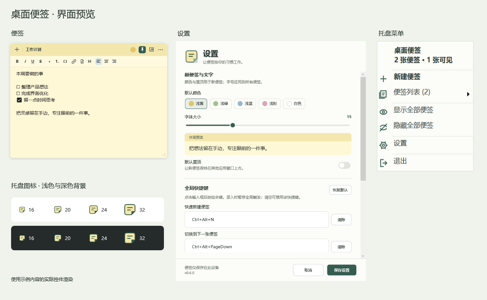
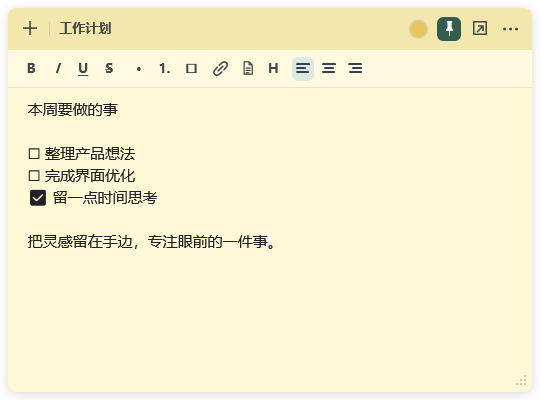
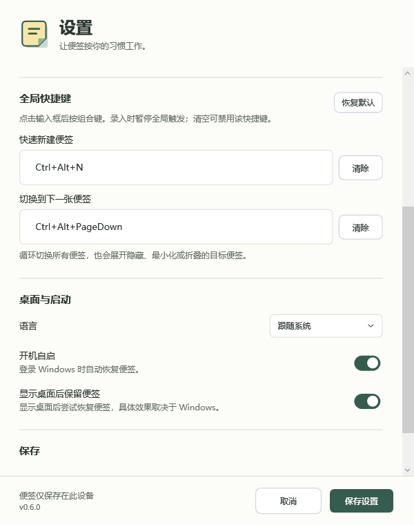

# DeskStickyNotes

DeskStickyNotes 是一个轻量、开源的 Windows 10/11 x64 桌面便签工具，延续 Windows 7 便签随手记录、常驻桌面的使用方式。

把提醒留在眼前，将重要便签置顶，或用键盘快速切换。软件采用原生 WPF 轻纸张界面，支持富文本、可拖动的折叠图标、托盘管理和本地保存，无需账号。

English: [README.md](README.md)

## 0.6.0 更新

- 可自定义全局快捷键：默认 `Ctrl+Alt+N` 新建，`Ctrl+Alt+PageDown` 循环切换，隐藏、最小化和折叠的便签也可直接唤出。
- 七种界面语言：简体中文、繁体中文、英语、法语、西班牙语、葡萄牙语和日语。
- 更新便签控件、右下角托盘图标与菜单、设置界面，加入外观预览和固定保存/取消栏。
- 统一协调桌面恢复，避免重叠便签反复争抢置顶而闪烁；折叠图标保留原有置顶偏好。

[下载 0.6.0](https://github.com/ht7850142/DeskStickyNotes/releases/tag/v0.6.0) · [完整更新记录](CHANGELOG.md)

## AI 辅助开发

本项目使用 AI 辅助完成实现、UI 迭代、文档和打包。[开发提示词](docs/开发提示词.md)随版本维护，说明当前 0.6.0 的产品行为、交互和工程要求，并非原始对话的逐字记录；历史修订保留在 Git 中。

## 项目定位

Windows 11 自带 Sticky Notes 更像普通应用窗口。DeskStickyNotes 的定位更窄：让便签出现在桌面上，并且在需要时可以置顶保持可见。

- 桌面优先的便签窗口
- 单个便签可置顶
- 可折叠为小图标，减少遮挡
- 系统托盘管理
- 本地 JSON 保存
- 支持安装包和绿色版
- 简单富文本，而不是大型笔记软件

## 优势和强项

- **Windows 11 上可见的桌面便签**：便签更像轻量桌面组件，而不是一个完整笔记工作区。
- **单个便签可置顶**：重要便签可以固定在其他窗口上方，适合临时任务、提醒、待办和参考信息。
- **折叠成小图标**：置顶便签不想占空间时，可以折叠成可拖动小图标，需要时再展开。
- **托盘管理，不占任务栏**：普通便签窗口不显示任务栏按钮，通过系统托盘新建、显示、隐藏、设置和退出。
- **本地优先，更私密**：便签以 JSON 保存在 `%AppData%`，没有账号、同步、广告、遥测或网络功能。
- **小而够用的富文本**：支持加粗、斜体、下划线、删除线、待办、标题、对齐、超链接、文本切片、颜色和单便签透明度。
- **安装包和绿色版都支持**：可选择小体积 framework-dependent 包，也可选择自包含/内置运行时包。
- **开源且 AI 辅助开发**：代码结构清楚，文档完整，并保留原始开发提示词。

## 适合谁

- 怀念 Windows 7 便签体验的 Windows 11 用户
- 希望重要便签始终显示在其他窗口上方的用户
- 希望用小图标保留置顶提醒、减少遮挡的用户
- 不想登录账号、不想同步云端的便签用户
- 想要托盘管理、桌面显示的轻量便签用户
- 想找开源 Windows sticky notes 工具的用户
- 想参考 WPF/.NET 桌面应用结构的开发者

## 功能

- 多个独立便签窗口
- 双击标题栏、右键标题栏/折叠图标或按 F2，分别为每个便签改名，名称自动保存
- 右键右下角托盘图标，查看便签列表及显示状态，分别选择显示或隐藏
- 普通便签不显示任务栏按钮
- 系统托盘菜单：新建、显示全部、隐藏全部、设置、退出
- 双击托盘图标显示已有便签
- 自定义全局快捷键，快速新建和依次切换便签，隐藏、最小化或折叠的便签也可直接唤出
- 自动保存内容、位置、大小、颜色、透明度、文字颜色、显示状态和置顶状态
- 单个便签可调整背景透明度，并支持自动、深色和浅色文字
- 富文本：加粗、斜体、下划线、删除线、列表、待办、标题、对齐、超链接
- 可把选中文字或剪贴板中的长文本收纳为紧凑切片，单击后预览全文
- 可将常见文本、Markdown、JSON、CSV、日志和代码文件拖入便签，或从文件选择器导入
- 文本文件以本地快照保存，原文件移动或删除后仍可预览
- 启动时恢复便签
- 单个便签可置顶
- 可折叠成可拖动的小图标
- 拖动便签四边或四角调整大小，空白便签也会记住调整后的尺寸
- 可缩小到 300 × 180，工具栏按功能分组换行，显示当前文字格式，支持键盘操作
- 单击标题栏保持展开，拖动可移动；使用独立按钮折叠，展开后保留原有置顶设置
- 空白便签提供输入提示，长便签按需显示滚动条；折叠后也可按 Enter 或空格展开
- 图标在屏幕边缘展开时，自动调整位置以保持便签位于当前显示器的可用区域内
- 可选的 Win+D 后保持显示机制
- 简体中文、繁体中文、英语、法语、西班牙语、葡萄牙语和日语界面，支持自动识别系统语言
- 支持开机自启
- 数据保存在 `%AppData%\DeskStickyNotes`

### 全局快捷键

默认按 `Ctrl+Alt+N` 新建便签，按 `Ctrl+Alt+PageDown` 切换到下一张便签。切换按创建顺序循环，会自动显示隐藏、最小化或折叠的目标便签。

打开**设置 → 全局快捷键**，点击输入框后直接按下想用的组合键。组合中须包含 Ctrl、Alt 或 Win，可再加 Shift。清空输入框即可停用该快捷键，点击“恢复默认”可还原两组默认值。录入时会暂停全局快捷键；保存时检查重复和占用，若新组合不可用，原来可用的快捷键仍会保留。

### 界面语言

在**设置 → 桌面与启动 → 语言**中选择“跟随系统”、简体中文、繁體中文、English、Français、Español、Português 或 日本語，保存后即可切换，无需重启。跟随系统会识别 Windows 界面语言并区分简繁中文，未支持的语言回退为英语。

### 文本切片

- 选中便签中的文字后，点击工具栏的文档图标，即可收纳为切片。
- 复制一整段文字后可选择“粘贴剪贴板为切片”，也可直接按 `Ctrl+Shift+V`。
- 将文本文件拖到便签编辑区，松开后会生成一个可点击的文件切片；也可以通过切片菜单选择文件。
- 单击切片可在独立预览窗口查看、滚动、自动换行或复制全文。
- 每个文本切片最大 2 MB，单张便签的文本切片总量最大 8 MB。

## 下载安装

从 [GitHub Releases 下载 DeskStickyNotes 0.6.0](https://github.com/ht7850142/DeskStickyNotes/releases/tag/v0.6.0)。

推荐使用[内置 .NET Desktop Runtime 的安装包](https://github.com/ht7850142/DeskStickyNotes/releases/download/v0.6.0/DeskStickyNotesSetup-0.6.0-runtime.exe)。不想安装时可选择[自包含绿色版 ZIP](https://github.com/ht7850142/DeskStickyNotes/releases/download/v0.6.0/DeskStickyNotes-portable-0.6.0-win-x64-runtime.zip)。

| 包 | 适合场景 |
| --- | --- |
| `DeskStickyNotesSetup-*-fd.exe` | 已安装 .NET 8 Desktop Runtime，安装包较小 |
| `DeskStickyNotesSetup-*-runtime.exe` | 安装包内置 .NET 8 Desktop Runtime，体积较大 |
| `DeskStickyNotes-portable-*-fd.zip` | 绿色版，要求系统已有 .NET 8 Desktop Runtime |
| `DeskStickyNotes-portable-*-runtime.zip` | 自包含绿色版，不需要额外安装运行时 |

升级前先从托盘退出旧版，再覆盖安装。安装包支持自定义安装路径。安装版和绿色版都将便签与设置保存在 `%AppData%\DeskStickyNotes`，绿色版不会将数据写在程序旁边。Release 同时提供四个包的 SHA-256 校验清单。

## 首次使用

1. 启动后程序出现在右下角通知区域，没有旧便签时会创建一张便签。
2. 直接输入内容，按 `Ctrl+Alt+N` 新建，按 `Ctrl+Alt+PageDown` 依次切换。
3. 用图钉保持置顶，或使用独立折叠按钮变成可拖动的小图标；单击标题栏继续编辑，拖动可移动，双击或按 F2 改名。
4. 右键托盘图标管理每张便签的显示状态，进入设置调整外观、快捷键和语言。

## 界面预览

以下图片使用 0.6.0 编译后的真实控件与示例便签渲染，不包含私人便签数据。

需要对外介绍软件时，可使用 [0.6.0 发布素材](assets/banners/desksticky-0.6.0/README.md)，内含中英文发布图、原始界面图和可编辑源文件。[发布指南](docs/PUBLISHING.md)整理了渠道优先级、核实依据及可直接修改使用的中英文稿件。

### 便签、设置和托盘



### 便签窗口



### 自定义全局快捷键



## 开发环境

- Windows 10/11
- .NET 8 Desktop SDK
- Inno Setup 6，仅打安装包时需要

安装 SDK：

```powershell
winget install Microsoft.DotNet.SDK.8
```

## 运行

```powershell
dotnet run --project .\src\DeskStickyNotes\DeskStickyNotes.csproj
```

程序会启动到系统托盘。如果没有任何旧便签，会自动创建一个默认便签。

## 构建

```powershell
dotnet build -c Release
```

运行 Windows 回归检查，覆盖原生窗口层级、全局快捷键注册与冲突、本地保存及七种语言的布局：

```powershell
dotnet run --project tests/DeskStickyNotes.RegressionTests -c Release
```

## 打包

生成小安装包和绿色版：

```powershell
powershell -ExecutionPolicy Bypass -File .\scripts\package.ps1
```

生成全部安装包和绿色版：

```powershell
powershell -ExecutionPolicy Bypass -File .\scripts\package.ps1 -AllInstallers
```

当前输出：

```text
artifacts\installer\DeskStickyNotes-portable-0.6.0-win-x64-fd.zip
artifacts\installer\DeskStickyNotes-portable-0.6.0-win-x64-runtime.zip
artifacts\installer\DeskStickyNotesSetup-0.6.0-fd.exe
artifacts\installer\DeskStickyNotesSetup-0.6.0-runtime.exe
artifacts\installer\DeskStickyNotes-0.6.0-SHA256SUMS.txt
```

生成内置运行时的安装包时，打包脚本会自动下载并校验缺失的运行时安装器：

```text
windowsdesktop-runtime-8.0.31-win-x64.exe
```

这个文件不应该提交到 Git 仓库。

更多发布步骤见 [docs/RELEASE.md](docs/RELEASE.md)。

## 项目结构

```text
DeskStickyNotes.sln   Visual Studio / dotnet 解决方案
src/DeskStickyNotes/   WPF 应用源码
  Models/             数据模型和便签颜色
  Services/           存储、托盘、快捷键、桌面恢复、自启和多语言服务
  ViewModels/         MVVM 视图模型和命令
  Views/              WPF 窗口
  Localization/       七种界面的完整语言资源
  Themes/             共享控件样式、状态和界面设计变量
  Assets/             应用图标
installer/            Inno Setup 安装脚本和安装器图片
scripts/              打包脚本
docs/                 架构、发布指南、开发提示词和图片
```

## 数据和隐私

本项目没有账号、同步、广告、遥测或统计。数据只保存在本机：

```text
%AppData%\DeskStickyNotes\notes.json
%AppData%\DeskStickyNotes\settings.json
```

## 已知限制

`Win+D 后保持` 是尽力而为。Windows 的“显示桌面”属于 Shell 级行为，普通应用窗口无法在所有场景下完全模拟桌面图标或桌面组件。需要稳定保持可见时，建议使用置顶或折叠图标模式。

## 参与贡献

欢迎提 issue 和 pull request。请保持项目方向克制：原生 Windows、小体积、托盘管理、本地优先。

见 [CONTRIBUTING.md](CONTRIBUTING.md)。

## 许可证

MIT License，见 [LICENSE](LICENSE)。
